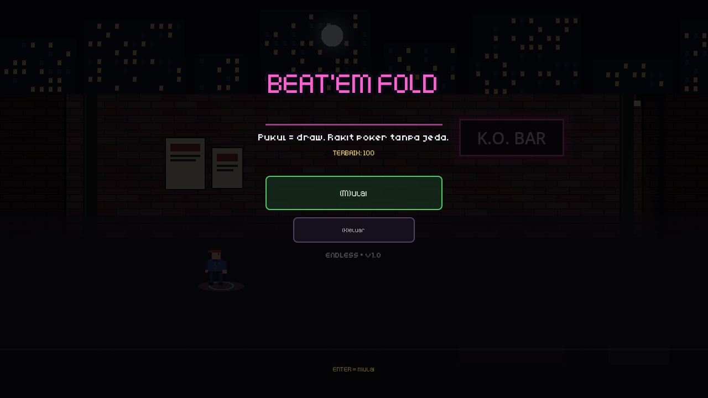
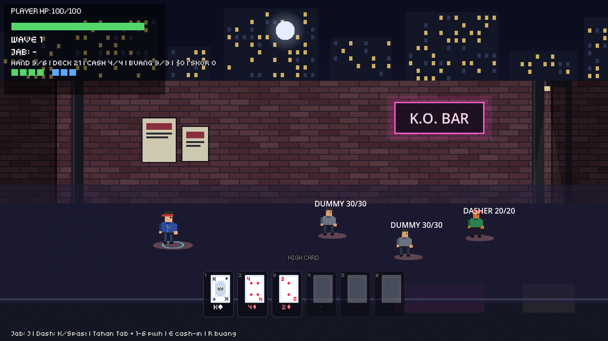
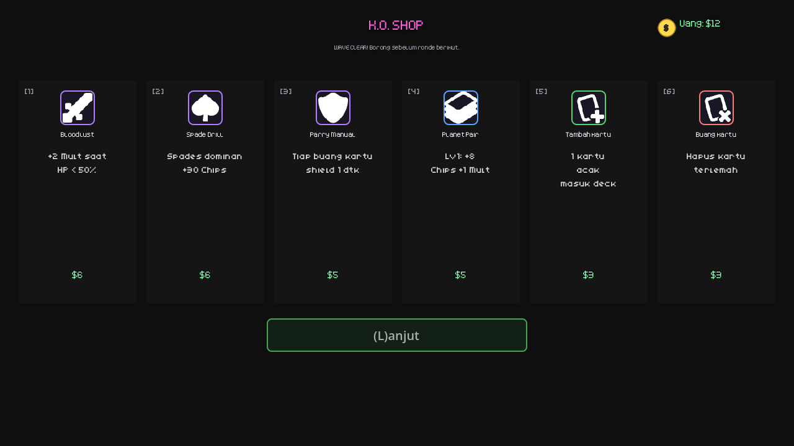
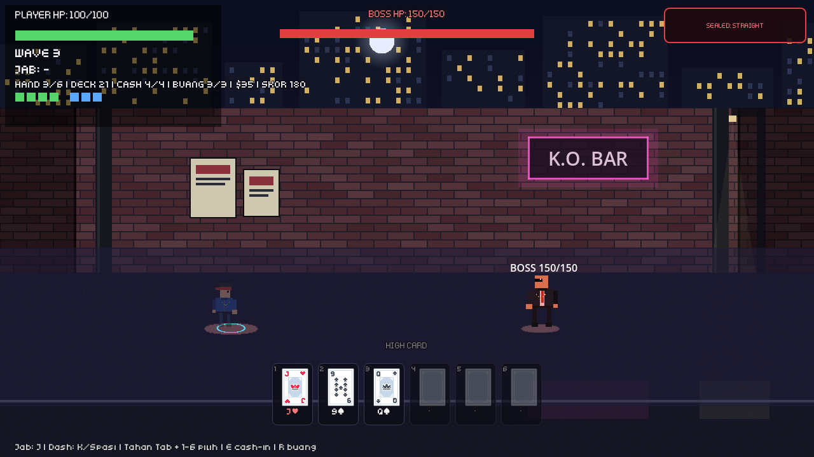

# Beat 'Em Fold

Beat 'em up + action-deckbuilder real-time. **Pukul = draw** — tiap jab yang kena narik 1 kartu, rakit poker hand tanpa jeda waktu, cash-in jadi jurus sesuai rank.



## Download (build siap pakai)

Rilis biner ada di [GitHub Releases](https://github.com/NessaRNG/BeatEmFold/releases) — nggak perlu pasang Godot buat main:

| Platform | File |
|---|---|
| Linux x86_64 | `BeatEmFold-Linux-x86_64` — `chmod +x` lalu jalankan |
| Windows x86_64 | `BeatEmFold-Windows-x86_64.exe` |
| Browser | `BeatEmFold-Web.zip` — ekstrak lalu buka lewat web server statis (bukan `file://`) |

Tiap rilis menyertakan `SHA256SUMS`; verifikasi dengan `sha256sum -c SHA256SUMS`. Build baru otomatis terbit saat tag `v*` di-push (GitHub Actions).

## Core Loop

1. **Berantem** — jab 3-hit, tiap kena = +1 kartu (maks 6 di tangan)
2. **Rakit** — tahan TAB + tombol 1-6 untuk pilih kartu, waktu tetap jalan
3. **Eksekusi** — lepas TAB + E: cash-in 2-5 kartu jadi AoE sesuai rank poker (Pair = single-lock, Flush = 360°, dst). Kosong = auto best-hand
4. **Belanja** — tiap wave clear: edit deck (tambah/hapus kartu). Lalu wave berikutnya, endless + scaling

Damage flat per rank poker + bonus suit simpel (Hearts = heal 8, Spades = x1.5, Clubs = stun, Diamonds = shield).



## Kontrol (keyboard penuh, mouse opsional)

| Aksi | Tombol |
|---|---|
| Gerak | WASD / Panah |
| Jab | J / Klik kiri |
| Dash (i-frame) | K / Spasi |
| Mode pilih kartu | Tahan Tab + 1-6 |
| Cash-In | E / Enter |
| Buang cepat | R |
| Shop | 1-2 beli, L lanjut |
| Pause / Ulangi / Menu | ESC / T / M |
| Tutorial | Y ya, N langsung main |
| Game over | C coba lagi, M menu |



## Fitur

- Endless run: Fight → Shop → Elite → Shop → Boss → scaling + seal boss rotasi (Straight/Flush/Pair)
- 3 stage ganti tiap 5 boss: ALLEY (gang malam) → ROOFTOP (senja) → CLUB (interior), ulang
- Tier mob ikut stage: ALLEY Striker/Dasher/Brute/Fury/Slammer/BOSS → ROOFTOP Punk/Runner/Enforcer/Berserker/Wrecker/KINGPIN → CLUB Razor/Volt/Titan/Ravager/Demolisher/DON (+dmg/speed/stat)
- Musuh ber-AI: Striker, Dasher (lunge), Fury (double-hit, tier 2 triple-hit), Slammer (mini-slam), Brute, Boss (slam + chase), token max 1-3 penyerang + skala agresi per loop (windup/speed/recover/hold/slam)
- Deck 24 kartu custom + tambah/hapus di shop, tanpa Joker/Planet/Chips x Mult
- Tutorial 7 langkah terpandu, menu/pause/game-over, skor + best tersimpan
- Juice: hit-stop, screenshake, damage number, partikel, hitspark, SFX Kenney



## Jalanin

Butuh **Godot 4.7**. Buka folder ini di Godot → F5 (`scenes/main.tscn`).

## Struktur

```
scripts/   player, dummy (musuh+AI), deck, hand_manager, poker_evaluator,
           combat_manager (cash-in), wave_manager, run_manager,
           shop_ui, hand_ui, tutorial, stage_bg (3 stage),
           thug_factory (18 look preman), ui_theme, ui_anim, key_button,
           sfx, pause_keys, char_sprites (hitspark), main (flow)
assets/    cards (Kenney), sfx (Kenney), icons (Kenney), fonts (Kenney),
           chars/bg (OGA), bg/nightcity_sky.png (OGA fridaruiz), LICENSE-*.txt
tests/     test_step1-12 (smoke) + balance_report, dijalankan:
           godot --headless --path . -s tests/test_stepN.gd
docs/      GDD.md, DECISIONS.md, PROGRESS.md (desain, di folder root), shots/
```

Desain lengkap: [GDD.md](GDD.md), [keputusan](DECISIONS.md), [progres](PROGRESS.md).

## Aset (semua CC0)

- Kenney.nl: Playing Cards, Impact/Interface/Casino Audio, Board Game Icons, Fonts (`assets/LICENSE-kenney.txt`)
- Chewbatrij — Beat em Up Graphics Pack: hitspark (`assets/LICENSE-oga.txt`)
- fridaruiz — pixel night city: sky alley (`assets/LICENSE-oga.txt`)
- Karakter preman (18 look) + foreground stage: prosedural (ThugFactory, StageBg)
